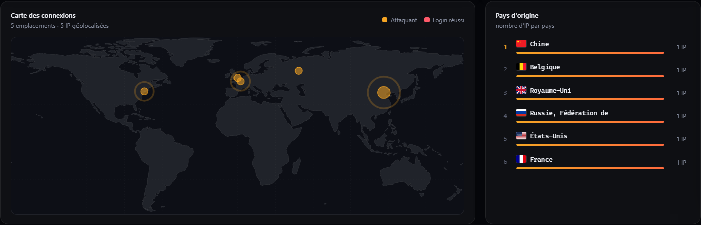
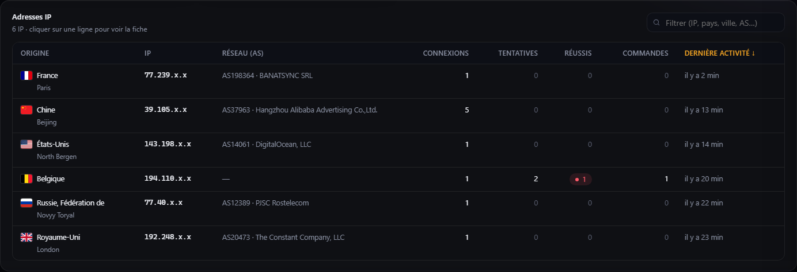
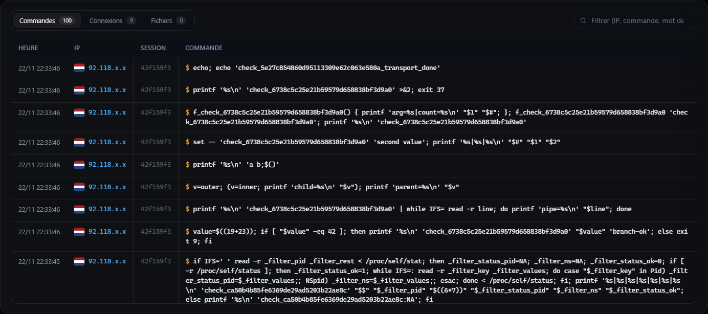

# 🍯 Mon honeypot Cowrie

J'ai pris un petit VPS (Debian 13) et j'ai installé dessus **[Cowrie](https://github.com/cowrie/cowrie)**, un honeypot SSH/Telnet. Le but : laisser les bots d'Internet croire qu'ils ont trouvé un serveur Linux mal protégé, et regarder ce qu'ils font une fois « dedans ».

Lire les logs JSON de Cowrie à la main, c'est vite pénible, alors j'ai codé un **panel web** pour voir les attaques en direct : d'où elles viennent, quels mots de passe sont essayés, quelles commandes sont tapées, quels fichiers sont téléchargés.


> Sur les captures, les IP sont masquées (`39.105.x.x`) et les connexions de mes propres tests sont anonymisées.

---

## Comment c'est monté

```
          Internet (bots, scanners…)
                     │
          port 22 (SSH) / 23 (Telnet)
                     ▼
 ┌─────────────────────────────────────────────┐
 │ VPS Debian  ·  UFW                          │
 │                                             │
 │  ┌──────────────┐  logs JSON  ┌──────────┐  │
 │  │   Cowrie     │ ──────────▶ │  Panel   │  │
 │  │ (faux shell) │  (lecture)  │  Flask   │  │
 │  └──────────────┘             └────┬─────┘  │
 │                     127.0.0.1:8080 │        │
 │  mon vrai SSH : autre port, par clé│        │
 └────────────────────────────────────┼────────┘
                                      ▲
                        tunnel SSH depuis mon PC
```

- **Cowrie** tourne dans un conteneur Docker et écoute sur les ports **22** et **23**, ceux que les bots scannent en permanence. Il simule un vrai système : faux shell, faux système de fichiers, et il accepte certains mots de passe pour que l'attaquant continue. Tout est enregistré, mais rien n'est réellement exécuté sur le VPS.
- Mon **vrai SSH** a été déplacé sur un autre port, avec connexion par clé uniquement.
- **UFW** bloque tout sauf mon port SSH et les ports 22/23 du honeypot.
- Le **panel** lit les logs de Cowrie en lecture seule et n'écoute que sur `127.0.0.1` : pour le voir, j'ouvre un tunnel SSH depuis mon PC.

## Le panel

| Thème sombre | Thème clair |
|---|---|
|  |  |

Ce qu'il affiche, avec une actualisation toutes les 5 secondes :

**Les chiffres clés** : connexions, IP uniques, pays, tentatives de login, logins réussis, commandes tapées, fichiers capturés. Un badge `+N` apparaît quand il y a du nouveau.

**La carte des connexions** : un point par lieu, plus gros quand il y a plus de connexions, rouge quand un bot a réussi à se connecter. Le point pulse si l'IP a été active dans le dernier quart d'heure. À côté, le classement des pays avec leurs drapeaux.



**Les classements** : top IP, top combinaisons identifiant/mot de passe, identifiants et mots de passe les plus essayés, commandes les plus tapées, clients SSH utilisés par les bots.


**La liste des IP** : drapeau, ville, opérateur (numéro d'AS), nombre de connexions, de tentatives et de commandes, dernière activité. On peut trier et filtrer.



**La fiche d'une IP** : un clic sur n'importe quelle IP du panel ouvre sa fiche. On y trouve la géolocalisation, l'opérateur, la première et la dernière apparition, les identifiants essayés, chaque session avec les commandes tapées, les fichiers téléchargés, et des liens vers AbuseIPDB, Shodan, VirusTotal, GreyNoise…


**Bannir une IP** : dans la fiche d'une IP, le bouton « Bannir l'IP » la bloque au pare-feu du VPS (honeypot **et** vrai SSH). Les IP bannies sont listées dans une section dédiée, avec leur statut (bloquée, en attente, refusée) et un bouton pour les débannir.

**Le flux en direct** des commandes, des connexions et des fichiers, avec une recherche.




### Côté technique
- Un seul fichier Python (`panel/app.py`) : Flask pour l'API, et la page en HTML/CSS/JS sans framework. Les graphiques et la carte sont dessinés en SVG à la main.
- La **géolocalisation est hors ligne**. Au build de l'image, `panel/fetch_assets.py` télécharge la base gratuite [DB-IP Lite](https://db-ip.com/db/lite.php), le fond de carte Natural Earth et les drapeaux [flag-icons](https://github.com/lipis/flag-icons). Aucune IP n'est envoyée à une API externe.
- Routes d'API :
  - `GET /api/stats` : toutes les données du tableau de bord ;
  - `GET /api/ip/<ip>` : la fiche d'une IP ;
  - `POST /api/bans` et `DELETE /api/bans/<ip>` : bannir ou débannir une IP.

### Comment marche le ban
Le panel tourne dans Docker sans aucun droit sur le réseau du VPS, et je voulais que ça reste comme ça. Le bouton écrit donc seulement l'IP dans `bans/banlist.json`. C'est un petit service systemd sur l'hôte (`host/honeypot-bans.py`) qui surveille ce fichier et applique la liste au pare-feu.

- **Pourquoi nftables et pas `ufw deny`** : Docker publie les ports 22/23 du honeypot sans passer par UFW, donc un ban UFW ne bloquerait pas l'attaquant. Le service utilise une table nftables dédiée (`inet honeypot_ban`) accrochée en *prerouting* avec la priorité la plus haute : le paquet est jeté avant Docker et avant UFW.
- **Garde-fous** : le service refuse de bannir une IP privée, une IP de `bans/allowlist.txt`, ou l'IP d'une session SSH d'admin ouverte à ce moment-là, pour ne jamais s'enfermer dehors.
- **Protection CSRF** : le panel n'a pas de mot de passe (c'est le tunnel SSH qui protège l'accès). Pour qu'un site web malveillant ne puisse pas bannir des IP via le tunnel, les requêtes de ban exigent un Host local, un Origin identique, et un en-tête `X-Panel` envoyé en JSON.

## Installer le même chez soi

Ce qu'il faut : un VPS sous Debian ou Ubuntu, et Docker.

**1. Déplacer son vrai SSH** pour libérer le port 22, dans `/etc/ssh/sshd_config.d/00-perso.conf` :
```
Port <ton-port>
PasswordAuthentication no
PermitRootLogin prohibit-password
```
> ⚠️ Avec OpenSSH, **c'est la première valeur lue qui gagne**, et les fichiers de `sshd_config.d/` sont lus par ordre alphabétique. Si ton hébergeur a déjà mis un fichier comme `50-cloud-init.conf` avec `PasswordAuthentication yes`, un fichier nommé `perso.conf` sera ignoré. C'est pour ça qu'il faut l'appeler `00-perso.conf` ; vérifie ensuite avec `sshd -T | grep -i password`.

```bash
ufw allow <ton-port>/tcp      # avant de redémarrer SSH, sinon tu t'enfermes dehors
systemctl restart ssh         # puis teste une nouvelle connexion avant de fermer l'ancienne
```

**2. Le pare-feu**
```bash
ufw default deny incoming
ufw default allow outgoing
ufw allow 22/tcp && ufw allow 23/tcp
ufw enable
```
> Docker publie ses ports **sans passer par UFW**. C'est pour ça que le panel est lié à `127.0.0.1:8080` et non à `8080` : même avec UFW mal réglé, il reste inaccessible depuis Internet.

**3. Lancer le honeypot**
```bash
curl -fsSL https://get.docker.com | sh
git clone https://github.com/itsP4lv/cowrie-honeypot.git honeypot
cd honeypot
docker compose up -d --build
```

**4. Installer le service de ban** (optionnel, nécessaire pour le bouton « Bannir »)
```bash
sh host/install.sh
```
Ajoute ton IP perso dans `bans/allowlist.txt` si elle est fixe.

**5. Ouvrir le panel depuis son PC**
```bash
ssh -N -p <ton-port> -L 8080:127.0.0.1:8080 root@IP_DU_VPS
```
puis **http://localhost:8080** dans le navigateur. Le panel n'a pas de mot de passe : c'est le tunnel SSH qui protège l'accès.

**Commandes utiles**
```bash
docker compose logs -f cowrie                 # logs bruts de Cowrie
docker compose restart panel                  # redémarrer le panel
docker compose build --build-arg GEO_MONTH=$(date +%Y-%m) panel && docker compose up -d panel   # mettre à jour la géoloc (1×/mois)
```

> J'ai d'abord testé tout ça en local sur Windows avec Docker Desktop : les notes sont dans [LISEZMOI.md](LISEZMOI.md).

## Sécurité

- Le panel n'est jamais exposé à Internet : il écoute sur `127.0.0.1`, et on y accède par tunnel SSH.
- Cowrie tourne dans un conteneur avec un faux système : un bot « connecté » n'a pas accès au vrai VPS.
- Le panel lit les logs en lecture seule (`/data:ro`).
- Tout ce que le panel affiche vient des attaquants (identifiants, commandes, URL). Ces textes sont insérés avec `textContent`, jamais `innerHTML`, donc un `<script>` tapé par un bot s'affiche comme du simple texte.
- Les malwares récupérés par Cowrie restent dans le volume Docker. Je ne les exécute jamais ; je les vérifie seulement par leur SHA-256 sur VirusTotal.

## Crédits
- [Cowrie](https://github.com/cowrie/cowrie) : le honeypot.
- [IP Geolocation by DB-IP](https://db-ip.com) (CC BY 4.0), [Natural Earth](https://www.naturalearthdata.com/), [flag-icons](https://github.com/lipis/flag-icons).
