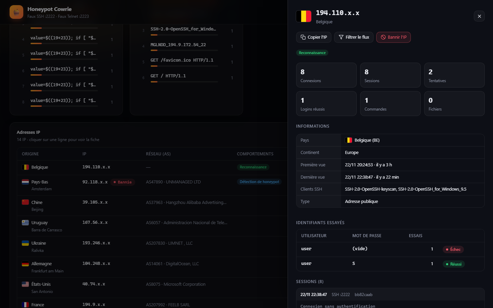
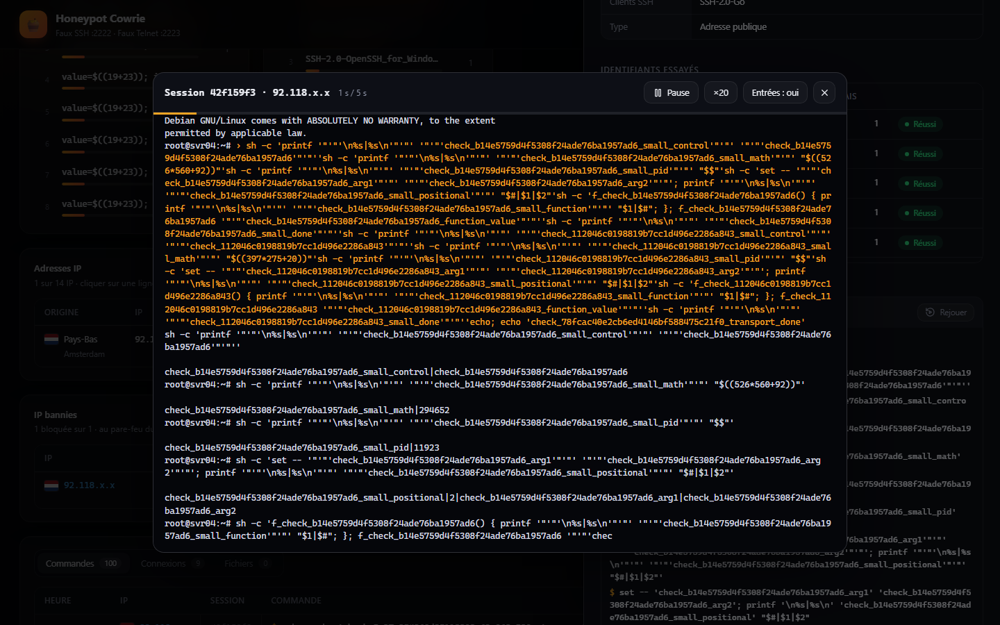
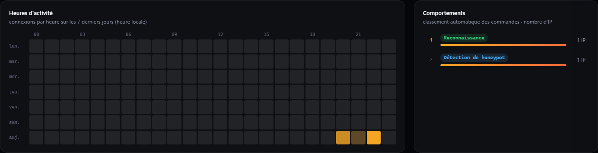

# 🍯 Mon honeypot Cowrie

J'ai pris un petit VPS (Debian 13) et j'ai installé dessus **[Cowrie](https://github.com/cowrie/cowrie)**, un honeypot SSH/Telnet, puis un faux serveur **Redis** que j'ai codé moi-même. Le but : laisser les bots d'Internet croire qu'ils ont trouvé un serveur Linux mal protégé, et regarder ce qu'ils font une fois « dedans ».

Lire les logs JSON de Cowrie à la main, c'est vite pénible, alors j'ai codé un **panel web** pour voir les attaques en direct : d'où elles viennent, quels mots de passe sont essayés, quelles commandes sont tapées, quels fichiers sont téléchargés.


> Sur les captures, les IP sont masquées (`39.105.x.x`) et les connexions de mes propres tests sont anonymisées.

---

## Comment c'est monté

```
          Internet (bots, scanners…)
                     │
          port 22 (SSH) / 23 (Telnet)
                     ▼
 ┌─────────────────────────────────────────────┐
 │ VPS Debian  ·  UFW                          │
 │                                             │
 │  ┌──────────────┐  logs JSON  ┌──────────┐  │
 │  │   Cowrie     │ ──────────▶ │  Panel   │  │
 │  │ (faux shell) │  (lecture)  │  Flask   │  │
 │  └──────────────┘             └────┬─────┘  │
 │                     127.0.0.1:8080 │        │
 │  mon vrai SSH : autre port, par clé│        │
 └────────────────────────────────────┼────────┘
                                      ▲
                        tunnel SSH depuis mon PC
```

- **Cowrie** tourne dans un conteneur Docker et écoute sur les ports **22** et **23**, ceux que les bots scannent en permanence. Il simule un vrai système : faux shell, faux système de fichiers, et il accepte certains mots de passe pour que l'attaquant continue. Tout est enregistré, mais rien n'est réellement exécuté sur le VPS.
- Mon **vrai SSH** a été déplacé sur un autre port, avec connexion par clé uniquement.
- Un **faux Redis** (`honeypots/redis/`, Python sans dépendance) écoute sur le port **6379**, ouvert sans mot de passe comme les Redis mal configurés que les bots cherchent. Il répond aux commandes courantes et enregistre tout, mais n'exécute rien et ne se connecte nulle part (les `SLAVEOF`/`REPLICAOF` vers un serveur pirate sont juste notés).
- **UFW** bloque tout sauf mon port SSH et les ports 22/23/6379 des honeypots.
- Le **panel** lit les logs de Cowrie et du faux Redis en lecture seule et n'écoute que sur `127.0.0.1` : pour le voir, j'ouvre un tunnel SSH depuis mon PC.

## Le panel

En ouvrant le panel, on arrive sur une **page d'accueil** qui propose trois espaces, un peu comme la liste des serveurs de Pterodactyl :

- **Dashboard honeypot** (`/honeypot`) : tout ce qui est décrit ci-dessous ;
- **Centre de surveillance (SOC)** (`/soc`) : le bilan depuis la mise en ligne, du genre « en ligne depuis 1 j 16 h : 3 221 connexions de 182 IP venant de 45 pays, soit une toutes les 45 s ». On y trouve aussi un niveau de menace, la tendance sur 24 h, un journal des incidents classés par gravité, la chronologie des « premières fois » (premier login, premier fichier déposé, 1 000e connexion…), les services et opérateurs les plus visés, et un bouton pour copier le rapport en texte ;
- **Statut des services** (`/status`) : le serveur vérifie chaque minute des sites web et les ports du honeypot, et affiche leur état, le temps de réponse, la disponibilité sur 24 h et l'expiration du certificat TLS. La liste des sites se règle dans `.env` (`STATUS_SITES`).

| Thème sombre | Thème clair |
|---|---|
|  |  |

Il y a aussi deux autres thèmes, « Ptérodactyl » et « Terminal » (vert sur noir).

Ce qu'il affiche, avec une actualisation toutes les 5 secondes :

**Les chiffres clés** : connexions, IP uniques, pays, tentatives de login, logins réussis, commandes tapées, fichiers capturés. Un badge `+N` apparaît quand il y a du nouveau.

**La carte des connexions** : un point par lieu, plus gros quand il y a plus de connexions, rouge quand un bot a réussi à se connecter. Le point pulse si l'IP a été active dans le dernier quart d'heure. La zone où il fait nuit est assombrie. En plein écran, on peut zoomer, afficher les fuseaux horaires et voir l'heure locale de chaque attaquant. À côté, le classement des pays avec leurs drapeaux.


**Les classements** : top IP, top combinaisons identifiant/mot de passe, identifiants et mots de passe les plus essayés, commandes les plus tapées, clients SSH utilisés par les bots.


**La liste des IP** : drapeau, ville, opérateur (numéro d'AS), nombre de connexions, de tentatives et de commandes, dernière activité. On peut trier et filtrer.


**La fiche d'une IP** : un clic sur n'importe quelle IP du panel ouvre sa fiche. On y trouve la géolocalisation, l'opérateur, la première et la dernière apparition, les identifiants essayés, chaque session avec les commandes tapées, les fichiers téléchargés, et des liens vers AbuseIPDB, Shodan, VirusTotal, GreyNoise…



**Bannir une IP** : dans la fiche d'une IP, le bouton « Bannir l'IP » la bloque au pare-feu du VPS (honeypot **et** vrai SSH). Les IP bannies sont listées dans une section dédiée, avec leur statut (bloquée, en attente, refusée) et un bouton pour les débannir.

**Ban automatique** : une IP qui envoie plus de 30 commandes en 60 secondes (toutes sessions confondues) est bannie automatiquement pour 24 h, avec une alerte Discord/Telegram si elles sont configurées. Elle apparaît dans la liste avec un badge « Auto ». Les bans manuels n'expirent jamais. Les seuils se règlent dans `.env`.

**Signalement à AbuseIPDB** (optionnel) : le plugin AbuseIPDB de Cowrie signale chaque IP qui tente de se connecter, au plus une fois par 24 h. La clé se met dans `.env` (`ABUSEIPDB_API_KEY`, avec `ABUSEIPDB_ENABLED=true`). Au départ, je l'avais réglé sur 10 tentatives avant de signaler, mais la plupart des bots n'essaient que 1 ou 2 mots de passe : presque rien n'était envoyé.

**Rejouer une session** : Cowrie enregistre tout l'écran de chaque session. Le bouton « Rejouer » de la fiche la repasse comme une vidéo (vitesse ×1 à ×20). Ici, le bot de détection de honeypot dont je parle plus bas, en train de tester le faux shell :



**Comportements et heures d'activité** : chaque session est classée automatiquement selon les commandes tapées (reconnaissance, téléchargement de payload, mineur de crypto, botnet, persistance, effacement de traces, détection de honeypot, attaque Redis…). Une carte de chaleur montre à quelles heures les bots attaquent.



**Alertes et VirusTotal** (optionnels) : un message Discord ou Telegram quand un bot réussit à se connecter, dépose un fichier ou vient d'un nouveau pays ; et la réputation VirusTotal de chaque fichier capturé, recherchée **par son hash uniquement**.

**Le flux en direct** des commandes, des connexions et des fichiers, avec une recherche.


### Côté technique
- **Python + Flask** côté serveur, page en HTML/CSS/JS sans framework (`panel/static/`). Les graphiques, la carte et le lecteur de sessions sont faits à la main.
- **SQLite** : un thread lit les nouvelles lignes des logs au fil de l'eau (`panel/store.py`) au lieu de tout relire toutes les 5 s. Chaque événement est étiqueté avec le honeypot qui l'a produit, pour pouvoir en ajouter d'autres (voir [docs/ajouter-un-honeypot.md](docs/ajouter-un-honeypot.md)).
- Modules : `geoip.py` (géoloc), `tags.py` (règles de classement), `alerts.py` (Discord/Telegram), `vt.py` (VirusTotal), `tty.py` (lecture des enregistrements de Cowrie), `autoban.py` (ban automatique), `soc.py` (vue SOC).
- La **géolocalisation est hors ligne**. Au build de l'image, `panel/fetch_assets.py` télécharge la base gratuite [DB-IP Lite](https://db-ip.com/db/lite.php), le fond de carte Natural Earth et les drapeaux [flag-icons](https://github.com/lipis/flag-icons). Aucune IP n'est envoyée à une API externe.
- Routes d'API :
  - `GET /api/stats` : toutes les données du tableau de bord ;
  - `GET /api/soc` : le bilan de la page SOC ;
  - `GET /api/ip/<ip>` : la fiche d'une IP ;
  - `GET /api/tty/<session>` : l'enregistrement d'une session ;
  - `POST /api/bans` et `DELETE /api/bans/<ip>` : bannir ou débannir une IP ;
  - `POST /api/alerts/test` : envoyer une alerte de test.

### Configuration (optionnelle)
Les secrets vont dans un fichier `.env`, jamais commité. Pour le créer : `cp .env.example .env`, remplir, puis `docker compose up -d panel`.

| Variable | Rôle |
|---|---|
| `ALERT_DISCORD_WEBHOOK` | URL du webhook Discord |
| `ALERT_TELEGRAM_TOKEN` / `ALERT_TELEGRAM_CHAT` | bot Telegram et id du chat |
| `ALERT_EVENTS` | `login,file,country` par défaut |
| `VT_API_KEY` | clé VirusTotal (gratuite) |
| `PANEL_IGNORE_IPS` | mes propres IP, jamais comptées comme des attaques (séparées par des virgules) |
| `AUTOBAN_ENABLED` | ban automatique des IP qui spamment les commandes (`true` par défaut) |
| `AUTOBAN_COMMANDS` / `AUTOBAN_WINDOW` | seuil : plus de 30 commandes en 60 s par défaut |
| `AUTOBAN_HOURS` | durée du ban automatique, 24 h par défaut (`0` = définitif) |
| `ABUSEIPDB_ENABLED` / `ABUSEIPDB_API_KEY` | signalement des IP à AbuseIPDB (relancer avec `docker compose up -d cowrie`) |

Les alertes contiennent des textes écrits par les attaquants : ils sont nettoyés (caractères de contrôle, longueur), les mentions Discord sont désactivées (pas de `@everyone` déclenché par un bot), et il y a un anti-spam (une même alerte au plus toutes les 30 min, 30 par heure maximum).

### Comment marche le ban
Le panel tourne dans Docker sans aucun droit sur le réseau du VPS, et je voulais que ça reste comme ça. Le bouton écrit donc seulement l'IP dans `bans/banlist.json`. C'est un petit service systemd sur l'hôte (`host/honeypot-bans.py`) qui surveille ce fichier et applique la liste au pare-feu.

- **Pourquoi nftables et pas `ufw deny`** : Docker publie les ports 22/23 du honeypot sans passer par UFW, donc un ban UFW ne bloquerait pas l'attaquant. Le service utilise une table nftables dédiée (`inet honeypot_ban`) accrochée en *prerouting* avec la priorité la plus haute : le paquet est jeté avant Docker et avant UFW.
- **Garde-fous** : le service refuse de bannir une IP privée, une IP de `bans/allowlist.txt`, ou l'IP d'une session SSH d'admin ouverte à ce moment-là, pour ne jamais s'enfermer dehors.
- **Protection CSRF** : le panel n'a pas de mot de passe (c'est le tunnel SSH qui protège l'accès). Pour qu'un site web malveillant ne puisse pas bannir des IP via le tunnel, les requêtes de ban exigent un Host local, un Origin identique, et un en-tête `X-Panel` envoyé en JSON.

## Installer le même chez soi

Ce qu'il faut : un VPS sous Debian ou Ubuntu, et Docker.

**1. Déplacer son vrai SSH** pour libérer le port 22, dans `/etc/ssh/sshd_config.d/00-perso.conf` :
```
Port <ton-port>
PasswordAuthentication no
PermitRootLogin prohibit-password
```
> ⚠️ Avec OpenSSH, **c'est la première valeur lue qui gagne**, et les fichiers de `sshd_config.d/` sont lus par ordre alphabétique. Si ton hébergeur a déjà mis un fichier comme `50-cloud-init.conf` avec `PasswordAuthentication yes`, un fichier nommé `perso.conf` sera ignoré. C'est pour ça qu'il faut l'appeler `00-perso.conf` ; vérifie ensuite avec `sshd -T | grep -i password`.

```bash
ufw allow <ton-port>/tcp      # avant de redémarrer SSH, sinon tu t'enfermes dehors
systemctl restart ssh         # puis teste une nouvelle connexion avant de fermer l'ancienne
```

**2. Le pare-feu**
```bash
ufw default deny incoming
ufw default allow outgoing
ufw allow 22/tcp && ufw allow 23/tcp && ufw allow 6379/tcp
ufw enable
```
> Docker publie ses ports **sans passer par UFW**. C'est pour ça que le panel est lié à `127.0.0.1:8080` et non à `8080` : même avec UFW mal réglé, il reste inaccessible depuis Internet.

**3. Lancer le honeypot**
```bash
curl -fsSL https://get.docker.com | sh
git clone https://github.com/itsP4lv/cowrie-honeypot.git honeypot
cd honeypot
docker compose up -d --build
```

**4. Installer le service de ban** (optionnel, nécessaire pour le bouton « Bannir »)
```bash
sh host/install.sh
```
Ajoute ton IP perso dans `bans/allowlist.txt` si elle est fixe.

**5. Ouvrir le panel depuis son PC**
```bash
ssh -N -p <ton-port> -L 8080:127.0.0.1:8080 root@IP_DU_VPS
```
puis **http://localhost:8080** dans le navigateur. Le panel n'a pas de mot de passe : c'est le tunnel SSH qui protège l'accès.

**Commandes utiles**
```bash
docker compose logs -f cowrie                 # logs bruts de Cowrie
docker compose restart panel                  # redémarrer le panel
docker compose build --build-arg GEO_MONTH=$(date +%Y-%m) panel && docker compose up -d panel   # mettre à jour la géoloc (1×/mois)
```

> J'ai d'abord testé tout ça en local sur Windows avec Docker Desktop : les notes sont dans [LISEZMOI.md](LISEZMOI.md).

## Sécurité

- Le panel n'est jamais exposé à Internet : il écoute sur `127.0.0.1`, et on y accède par tunnel SSH.
- Cowrie tourne dans un conteneur avec un faux système : un bot « connecté » n'a pas accès au vrai VPS.
- Le faux Redis tourne dans un conteneur durci (non-root, lecture seule, aucune capacité Linux, 128 Mo de RAM) et n'utilise que la bibliothèque standard de Python.
- Le panel lit les logs en lecture seule (`/data:ro`).
- Le conteneur du panel est durci : utilisateur non-root, système de fichiers en lecture seule, aucune capacité Linux, `no-new-privileges`, mémoire et nombre de processus limités. Il tourne sous gunicorn, pas avec le serveur de développement de Flask.
- En-têtes HTTP : CSP stricte (aucun script externe ni inline), `X-Frame-Options`, `nosniff`, `no-referrer`. Toutes les requêtes dont l'en-tête Host n'est pas local sont refusées (protection contre le DNS rebinding à travers le tunnel).
- Tout ce que le panel affiche vient des attaquants (identifiants, commandes, URL). Ces textes sont insérés avec `textContent`, jamais `innerHTML`, donc un `<script>` tapé par un bot s'affiche comme du simple texte.
- Les malwares récupérés par Cowrie restent dans le volume Docker. Je ne les exécute jamais ; je les vérifie seulement par leur SHA-256 sur VirusTotal.

## Crédits
- [Cowrie](https://github.com/cowrie/cowrie) : le honeypot.
- [IP Geolocation by DB-IP](https://db-ip.com) (CC BY 4.0), [Natural Earth](https://www.naturalearthdata.com/), [flag-icons](https://github.com/lipis/flag-icons).
