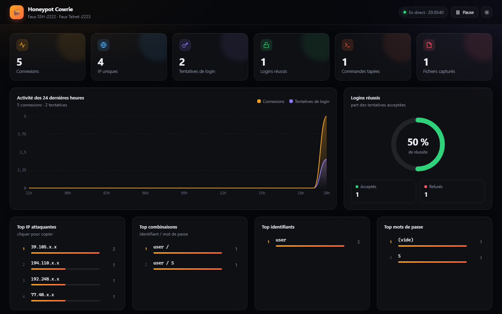
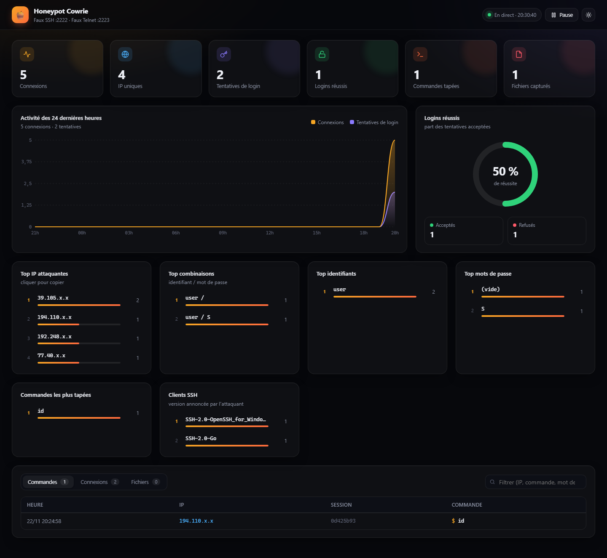
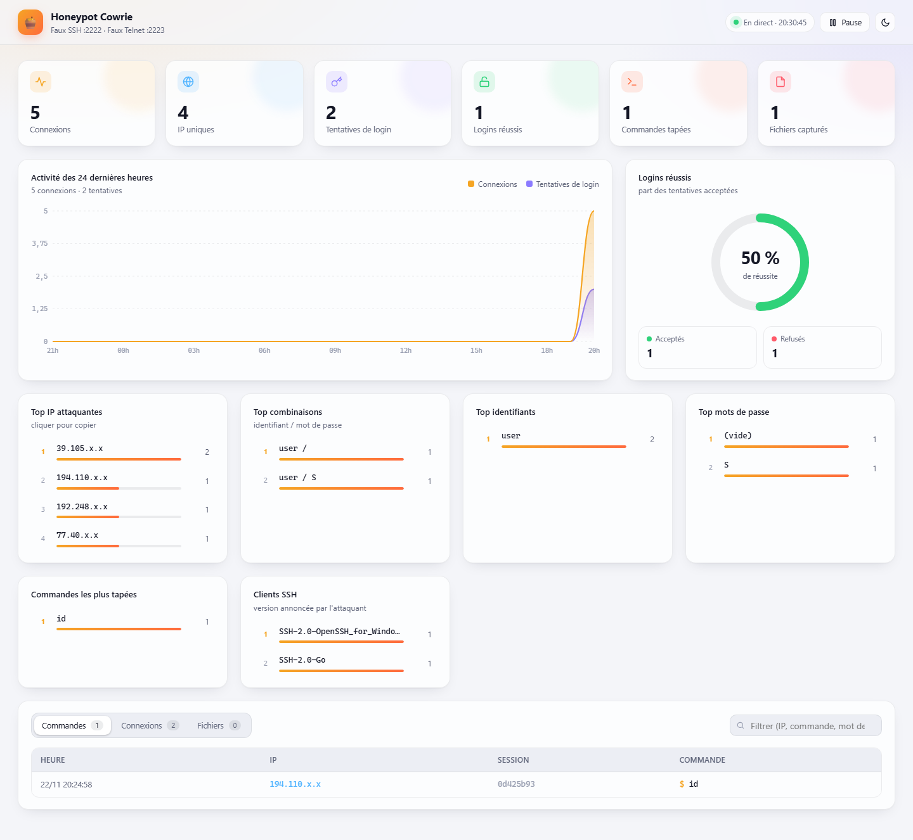
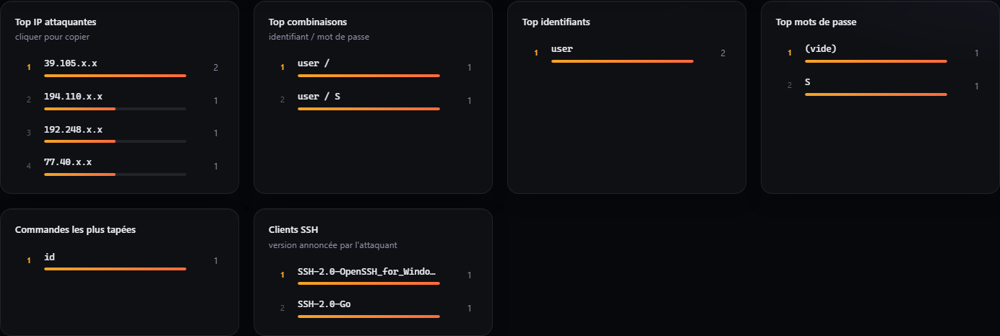
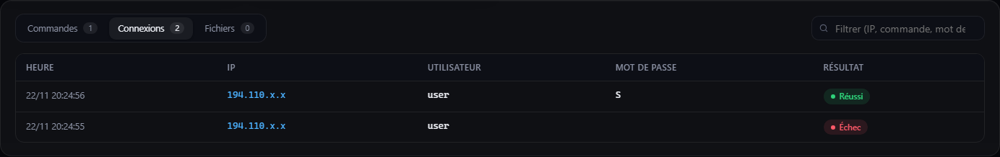

# 🍯 Honeypot Cowrie + panel web

Un honeypot SSH/Telnet basé sur [Cowrie](https://github.com/cowrie/cowrie), installé sur un VPS, avec un **panel web maison** qui affiche les attaques en direct : connexions, identifiants essayés, commandes tapées, fichiers téléchargés par les attaquants.



> Les IP et noms d'utilisateur des captures sont partiellement masqués.

---

## Sommaire
- [Comment ça marche](#comment-ça-marche)
- [Le panel web](#le-panel-web)
- [Installation sur un VPS](#installation-sur-un-vps)
- [Pare-feu (UFW)](#pare-feu-ufw)
- [Accéder au panel](#accéder-au-panel)
- [Tester le honeypot](#tester-le-honeypot)
- [Sécurité](#sécurité)
- [Structure du repo](#structure-du-repo)

---

## Comment ça marche

```
             Internet (bots, scanners, attaquants)
                            │
             ┌──────────────┴──────────────┐
             │ :22 / :23 (redirigés)       │ :2222 / :2223
             ▼                             ▼
   ┌──────────────────────────────────────────────┐
   │ VPS  ─  UFW (pare-feu)                       │
   │                                              │
   │  ┌───────────────┐   volume    ┌──────────┐  │
   │  │ cowrie        │──────────▶  │ panel    │  │
   │  │ faux SSH/Tel. │ cowrie.json │ Flask    │  │
   │  └───────────────┘  (lecture)  └────┬─────┘  │
   │                                     │        │
   │              127.0.0.1:8080 ◀───────┘        │
   │  vrai SSH d'admin : autre port, par clé      │
   └──────────────────────────────────────────────┘
                            ▲
                 tunnel SSH depuis mon PC
```

1. **Cowrie** simule un serveur Linux. Il accepte les connexions SSH (port 2222) et Telnet (port 2223), laisse les attaquants « se connecter » et enregistre tout ce qu'ils font dans `cowrie.json`. Rien n'est réellement exécuté : le shell est une imitation.
2. Le **panel** (Flask, un seul fichier Python) lit ces logs JSON en lecture seule via un volume Docker partagé et les expose sur `/api/stats`.
3. La page web interroge l'API toutes les 5 secondes et met à jour les graphiques sans recharger.

## Le panel web

| Thème sombre | Thème clair |
|---|---|
|  |  |

**Fonctionnalités**
- **6 indicateurs** : connexions, IP uniques, tentatives de login, logins réussis, commandes tapées, fichiers capturés (avec un badge `+N` quand de nouvelles attaques arrivent).
- **Graphique des 24 dernières heures**, heure par heure, avec infobulle au survol.
- **Taux de logins réussis** (donut acceptés / refusés).
- **Classements** : top IP, top combinaisons identifiant/mot de passe, top identifiants, top mots de passe, commandes les plus tapées, clients SSH utilisés.



- **Flux en direct** en 3 onglets (commandes, connexions, fichiers) avec filtre de recherche ; les nouvelles lignes clignotent à leur arrivée, un clic sur une IP la copie.




- Thème sombre/clair, bouton pause, actualisation auto toutes les 5 s.

**API** : `GET /api/stats` renvoie tout en JSON (totaux, classements, activité par heure, 100 dernières commandes et connexions, 50 derniers fichiers).

## Installation sur un VPS

Testé sur Debian/Ubuntu.

### 1. Déplacer le vrai SSH
Le port 22 doit être libéré pour le honeypot. Dans `/etc/ssh/sshd_config` :
```
Port 22222                 # exemple, choisis le tien
PasswordAuthentication no  # connexion par clé uniquement
PermitRootLogin no
```
```bash
sudo ufw allow 22222/tcp   # AVANT de redémarrer SSH, sinon tu t'enfermes dehors
sudo systemctl restart ssh
```
Ouvre une **nouvelle** session sur le nouveau port avant de fermer l'ancienne.

### 2. Installer Docker
```bash
curl -fsSL https://get.docker.com | sh
sudo usermod -aG docker $USER   # puis se reconnecter
```

### 3. Lancer le honeypot
```bash
git clone https://github.com/<ton-pseudo>/<ce-repo>.git honeypot
cd honeypot
docker compose up -d --build
```
- Faux SSH : **2222**, faux Telnet : **2223**
- Panel : **127.0.0.1:8080** (local au VPS uniquement)

### 4. Rediriger 22 → 2222 et 23 → 2223 (optionnel mais conseillé)
Les bots scannent surtout les ports 22 et 23. Dans `/etc/ufw/before.rules`, **avant** la section `*filter` :
```
*nat
:PREROUTING ACCEPT [0:0]
-A PREROUTING -p tcp --dport 22 -j REDIRECT --to-port 2222
-A PREROUTING -p tcp --dport 23 -j REDIRECT --to-port 2223
COMMIT
```
puis `sudo ufw reload`.

## Pare-feu (UFW)

```bash
sudo ufw default deny incoming
sudo ufw default allow outgoing
sudo ufw allow 22222/tcp   # vrai SSH d'admin
sudo ufw allow 22/tcp      # honeypot SSH (redirigé vers 2222)
sudo ufw allow 23/tcp      # honeypot Telnet (redirigé vers 2223)
sudo ufw enable
sudo ufw status verbose
```

> ⚠️ **Docker contourne UFW.** Un port publié par Docker (`ports:`) est ouvert sur Internet même si UFW ne l'autorise pas, car Docker écrit ses propres règles iptables. C'est pour ça que le panel est publié sur `127.0.0.1:8080` et pas sur `8080` : il n'est jamais exposé, quel que soit l'état d'UFW.

## Accéder au panel

Le panel n'écoute que sur le VPS. Depuis ton PC, ouvre un tunnel SSH :
```bash
ssh -p 22222 -L 8080:127.0.0.1:8080 utilisateur@IP_DU_VPS
```
puis ouvre **http://localhost:8080** dans ton navigateur. Le panel n'a pas d'authentification : c'est le tunnel SSH qui la remplace.

## Tester le honeypot

```bash
ssh root@IP_DU_VPS -p 2222
```
Par défaut Cowrie accepte `root` avec presque n'importe quel mot de passe (sauf `root` et `123456`). Tape `whoami`, `uname -a`, `cat /etc/passwd`, `wget http://example.com/test.sh`, puis regarde le panel.

Commandes utiles :
```bash
docker compose logs -f cowrie     # logs bruts de Cowrie
docker compose ps                 # état des conteneurs
docker compose restart            # redémarrer
docker compose down -v            # tout supprimer, logs capturés compris
```

## Sécurité

- **Le panel n'est jamais exposé à Internet** : lié à `127.0.0.1`, accès par tunnel SSH uniquement.
- **Le vrai SSH** est sur un autre port, par clé uniquement, root désactivé.
- **Cowrie tourne dans un conteneur**, sans privilèges, avec un faux système de fichiers : un attaquant « connecté » n'atteint pas le VPS.
- **Le panel monte les logs en lecture seule** (`/data:ro`).
- **Protection XSS** : tout ce qu'affiche le panel vient des attaquants (identifiants, commandes, URL). Ces données sont insérées avec `textContent`, jamais `innerHTML`, donc une commande du type `<script>…</script>` s'affiche comme du texte.
- **Fichiers capturés** : les malwares téléchargés par les attaquants sont stockés dans le volume Cowrie (`var/lib/cowrie/downloads`). Ne les exécute jamais ; analyse-les seulement dans une VM isolée ou via leur SHA-256 sur VirusTotal.

## Structure du repo

```
.
├── docker-compose.yml   # cowrie + panel, volume partagé
├── panel/
│   ├── app.py           # API Flask + page web (HTML/CSS/JS intégrés, sans dépendance front)
│   └── Dockerfile
├── screenshots/         # captures du panel
├── LISEZMOI.md          # version locale (Windows + Docker Desktop)
└── README.md
```

## Crédits
- [Cowrie](https://github.com/cowrie/cowrie) : le honeypot SSH/Telnet.
- Panel : Flask + SVG fait main, sans bibliothèque de graphiques.
